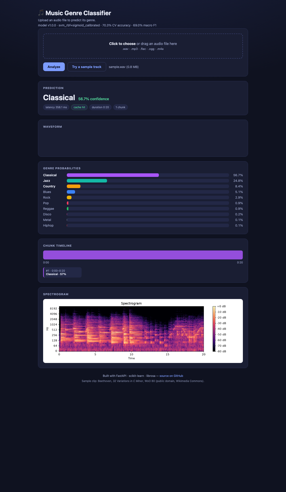

# Music Genre Classifier

[](https://github.com/devvevevv/music_genre_classifier/actions/workflows/ci.yml)

A machine-learning web app that predicts the **music genre** of any audio file
you upload. Upload a track and get the predicted genre, its confidence, the
full probability distribution over 10 genres, a per-chunk timeline, and a
spectrogram — all in a single-page dashboard.

> **Live demo:** <https://music-genre-classifier-c3zh.onrender.com>



## Try it live

Open the [live demo](https://music-genre-classifier-c3zh.onrender.com), upload any
`.mp3`, `.wav`, `.flac`, `.ogg`, or `.m4a` file (or click **"Try a sample
track"**), and it returns:

- the predicted genre and confidence,
- a ranked probability bar chart across all 10 genres,
- a waveform and spectrogram,
- a chunk timeline showing how the prediction varies across the track.

## Run it locally

You need Python 3.10+ (or Docker). All commands run from the repository root.

### With Docker (easiest)

```bash
docker build -t music-genre-classifier .
docker run -p 8000:8000 music-genre-classifier
```

Then open <http://localhost:8000/>.

### With Python

```bash
python -m venv venv
source venv/bin/activate            # Windows: venv\Scripts\activate
pip install -r requirements.txt
uvicorn app.main:app --port 8000
```

Open <http://localhost:8000/>.

## API

The service is FastAPI; docs auto-generate at <http://localhost:8000/docs>.

| Method | Path | Description |
| --- | --- | --- |
| `POST` | `/api/v1/predict` | Upload an audio file, get the genre prediction |
| `GET` | `/api/v1/health` | Liveness + model availability |
| `GET` | `/api/v1/model/info` | Model manifest (version, classes, metrics) |
| `GET` | `/api/v1/metrics/summary` | Cross-validated model comparison |
| `GET` | `/metrics` | Prometheus metrics |

Classify a file from the command line:

```bash
curl -F "file=@test/sample/blackSabbathParanoid.mp3" http://localhost:8000/api/v1/predict
```

## How it works

1. **Features** — librosa extracts 90 features per audio chunk: MFCCs, chroma
   (both STFT and CQT), spectral centroid/rolloff/contrast/bandwidth/flux,
   tempo, beat strength, and RMS.
2. **Chunking** — long tracks are split into overlapping 30 s windows; short
   clips are evaluated whole.
3. **Prediction** — an SVM (RBF) wrapped in `CalibratedClassifierCV` returns a
   calibrated probability per genre; per-chunk probabilities are averaged into
   the final distribution.

Genres: blues, classical, country, disco, hiphop, jazz, metal, pop, reggae, rock.

## Results

Models are compared with stratified 5-fold cross-validation on all 1000 GTZAN
tracks (details in `models/metrics.json`).

| Model | Accuracy | Macro F1 |
| --- | ---: | ---: |
| Dummy (most frequent) | 0.100 | 0.018 |
| Logistic regression | 0.717 | 0.716 |
| **SVM (RBF)** | **0.731** | **0.729** |
| Random forest | 0.729 | 0.725 |
| Histogram gradient boosting | 0.717 | 0.713 |

Per-class F1 for the selected SVM (RBF):

| blues | classical | country | disco | hiphop | jazz | metal | pop | reggae | rock |
| ---: | ---: | ---: | ---: | ---: | ---: | ---: | ---: | ---: | ---: |
| 0.802 | 0.895 | 0.673 | 0.660 | 0.698 | 0.827 | 0.847 | 0.739 | 0.674 | 0.471 |

The production model is the SVM wrapped in sigmoid calibration. Nested
cross-validation scores:

| Calibrated model | Accuracy | Macro F1 | Brier | Log loss |
| --- | ---: | ---: | ---: | ---: |
| SVM (RBF) + sigmoid | 0.703 | 0.690 | 0.527 | 1.087 |

## Training and evaluation

The dataset is [GTZAN](https://www.kaggle.com/datasets/andradaolteanu/gtzan-dataset-music-genre-classification),
laid out as `dataset/genres_original/<genre>/*.wav` where the subdirectory name
is the label (note `hiphop`, not `hip-hop`). Override the location with
`DATASET_DIR`.

```bash
python -m eval.features    # 1. Extract features once (~6 min, parallel)
python -m eval.evaluate    # 2. Compare models (5-fold CV) -> models/metrics.json
python -m eval.train       # 3. Train + calibrate -> models/model.pkl + metadata.json
```

A pre-trained model ships in `models/`, so you normally do not need to retrain.

## Testing and code quality

```bash
pip install -r requirements-dev.txt
ruff check .            # lint
ruff format --check .   # formatting
mypy src app            # type check
pytest --cov=src --cov=app
```

Tests use a synthetic tone and a tiny throwaway classifier (via the `MODEL_PATH`
env var), so they run without the dataset or a trained model.

## Project structure

```
src/                      # inference + feature extraction (flat modules)
  predictor.py            #   predict() / predict_detailed()
  feature_extraction.py   #   librosa feature extraction (90 features)
  spectrogram.py          #   PNG spectrogram renderer
  cache.py                #   Redis / in-process LRU prediction cache
  config.py  settings.py  #   constants + .env settings
app/                      # FastAPI service + dashboard
  main.py  schemas.py  observability.py
  static/index.html       #   single-page dashboard
  static/sample.wav       #   bundled public-domain demo clip
eval/                     # experiment + production training package
tests/                    # pytest suite (synthetic fixtures)
models/                   # model.pkl + metadata.json + metrics.json (committed)
Dockerfile  render.yaml  docker-compose.yml
```

## Credits

- **Sample clip:** Beethoven, *32 Variations in C Minor*, WoO 80 — public
  domain, sourced from [Wikimedia Commons](https://commons.wikimedia.org/).
- **Dataset:** [GTZAN](https://www.kaggle.com/datasets/andradaolteanu/gtzan-dataset-music-genre-classification).
